# Домашнее задание к занятию 1 «Введение в Ansible» — Мешков Сергей

---

## Подготовка к выполнению

### 1. Установка Ansible и создание репозитория

Ansible установлен на Ubuntu VM. Проверка версии:

```bash
ansible --version
```

Вывод (ключевая строка):
```
ansible [core 2.21.5]
```
*Версия соответствует требованиям (2.10+).*

Создан публичный репозиторий на GitHub, в него склонирован Playbook из репозитория с домашним заданием.

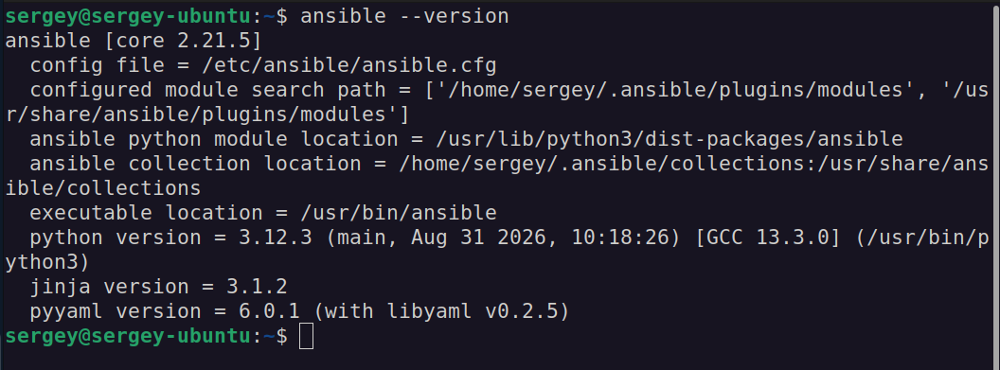
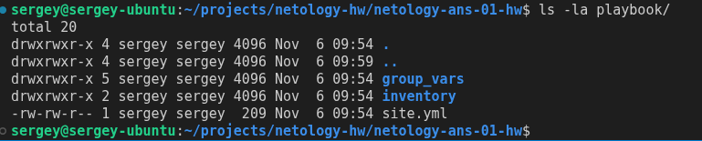

---

## Основная часть

### 1. Запуск playbook на окружении test.yml

В `inventory/test.yml` описан хост `localhost` с типом подключения `local`.

Запуск playbook:

```bash
ansible-playbook -i inventory/test.yml site.yml
```

**Результат:** факт `some_fact` для хоста `localhost` имеет значение **12** (а `ansible_distribution` — `Ubuntu`).

*Примечание:* В `site.yml` был обновлен синтаксис получения фактов с `ansible_distribution` на `ansible_facts['distribution']`, чтобы убрать предупреждение об устаревании (Deprecation Warning) в Ansible 2.21.

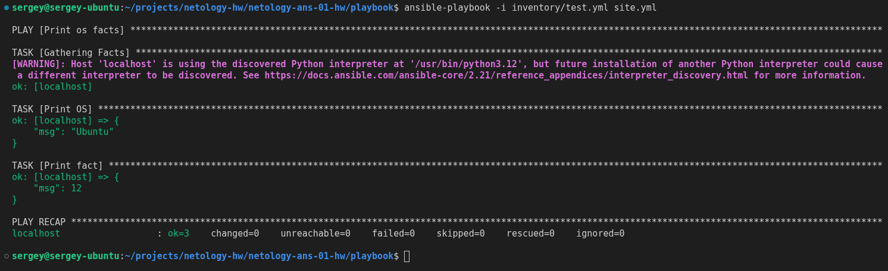

### 2. Изменение значения в group_vars

Найдено значение `12` в файле `playbook/group_vars/all/examp.yml`. Оно изменено на `all default fact`.

Повторный запуск:

```bash
ansible-playbook -i inventory/test.yml site.yml
```

**Результат:** `some_fact` теперь равен `all default fact`.

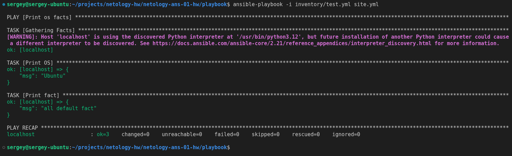

### 3. Подготовка Docker-окружения для prod.yml

Для запуска `prod.yml` подготовлены два Docker-контейнера (группы `deb` и `el`).

Запуск контейнеров:
```bash
docker run -d -it --name ubuntu ubuntu:latest
docker run -d -it --name centos8 pycontribs/centos:8
```

*Флаги:*
* `-d` — запуск в фоновом режиме (detach).
* `-it` — интерактивный режим с псевдо-терминалом.

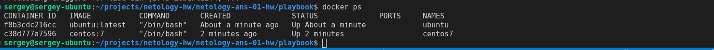

**Важный нюанс с CentOS 8 и Python:**
Ansible 2.21 требует Python 3.9+ на управляемых хостах, а в CentOS 8 из коробки стоит Python 3.6.8, что вызывало ошибку `SyntaxError: future feature annotations is not defined`.

Для решения этой проблемы были выполнены следующие шаги внутри контейнера `centos8`:
1. Репозитории CentOS 8 (EOL) переключены на архив `vault.centos.org`.
2. Установлен Python 3.9 из AppStream:
   ```bash
   # Домашнее задание к занятию 1 «Введение в Ansible» — Мешков Сергей

---

## Подготовка к выполнению

### 1. Установка Ansible и создание репозитория

Ansible установлен на Ubuntu VM. Проверка версии:

```bash
ansible --version
```

Вывод (ключевая строка):
```
ansible [core 2.21.5]
```
*Версия соответствует требованиям (2.10+).*

Создан публичный репозиторий на GitHub, в него склонирован Playbook из репозитория с домашним заданием.


---

## Основная часть

### 1. Запуск playbook на окружении test.yml

В `inventory/test.yml` описан хост `localhost` с типом подключения `local`.

Запуск playbook:

```bash
ansible-playbook -i inventory/test.yml site.yml
```

**Результат:** факт `some_fact` для хоста `localhost` имеет значение **12** (а `ansible_distribution` — `Ubuntu`).

*Примечание:* В `site.yml` был обновлен синтаксис получения фактов с `ansible_distribution` на `ansible_facts['distribution']`, чтобы убрать предупреждение об устаревании (Deprecation Warning) в Ansible 2.21.


### 2. Изменение значения в group_vars

Найдено значение `12` в файле `playbook/group_vars/all/examp.yml`. Оно изменено на `all default fact`.

Повторный запуск:

```bash
ansible-playbook -i inventory/test.yml site.yml
```

**Результат:** `some_fact` теперь равен `all default fact`.


### 3. Подготовка Docker-окружения для prod.yml

Для запуска `prod.yml` подготовлены два Docker-контейнера (группы `deb` и `el`).

Запуск контейнеров:
```bash
docker run -d -it --name ubuntu ubuntu:latest
docker run -d -it --name centos8 pycontribs/centos:8
```

*Флаги:*
* `-d` — запуск в фоновом режиме (detach).
* `-it` — интерактивный режим с псевдо-терминалом.


**Важный нюанс с CentOS 8 и Python:**
Ansible 2.21 требует Python 3.9+ на управляемых хостах, а в CentOS 8 из коробки стоит Python 3.6.8, что вызывало ошибку `SyntaxError: future feature annotations is not defined`.

Для решения этой проблемы были выполнены следующие шаги внутри контейнера `centos8`:
1. Репозитории CentOS 8 (EOL) переключены на архив `vault.centos.org`.
2. Установлен Python 3.9 из AppStream:
   ```bash
   docker exec centos8 bash -c "for f in /etc/yum.repos.d/CentOS-Linux-*.repo; do sed -i 's/mirrorlist/#mirrorlist/g' \"\$f\"; sed -i 's|#baseurl=http://mirror.centos.org|baseurl=http://vault.centos.org|g' \"\$f\"; done"
   docker exec centos8 dnf clean all
   docker exec centos8 dnf install -y python39
   ```

3. Команда `python3` принудительно перенаправлена на новую версию:
   ```bash
   docker exec centos8 ln -sf /usr/bin/python3.9 /usr/bin/python3
   ```
После этого Ansible смог успешно собрать факты (Gathering Facts) для CentOS.

### 4. Запуск playbook на prod.yml и фиксация значений

В инвентаре `inventory/prod.yml` обоим хостам добавлен тип подключения `ansible_connection: docker`.

Запуск:
```bash
ansible-playbook -i inventory/prod.yml site.yml
```

**Результат изначально:**
* `ubuntu` (группа `deb`) → `some_fact: "deb"`
* `centos8` (группа `el`) → `some_fact: "el"`

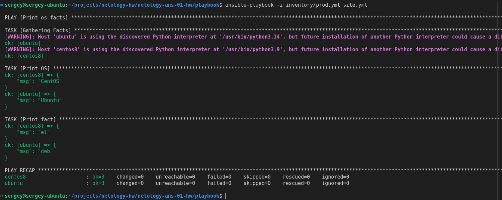

### 5. Изменение фактов в group_vars

Файлы `group_vars/deb/examp.yml` и `group_vars/el/examp.yml` отредактированы. Значения заменены на `deb default fact` и `el default fact` соответственно.

Запуск playbook подтвердил применение новых значений для обеих групп.

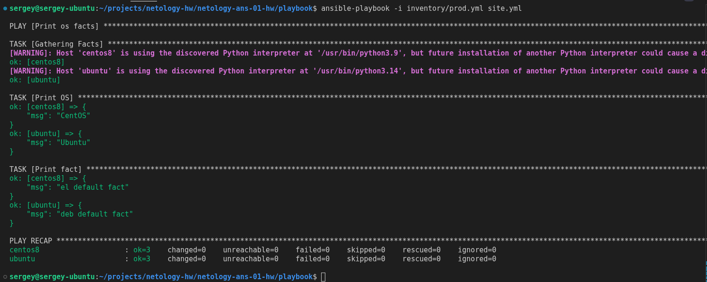

### 6. Шифрование данных через ansible-vault

Факты в `group_vars` зашифрованы с паролем `netology`:
```bash
ansible-vault encrypt group_vars/deb/examp.yml
ansible-vault encrypt group_vars/el/examp.yml
```
*Команда `encrypt` преобразует содержимое файла в зашифрованный формат AES256 (`$ANSIBLE_VAULT;1.1;AES256...`).*

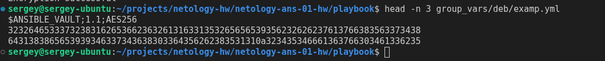

### 7. Запуск playbook с запросом пароля Vault

Запуск выполнен с флагом `--ask-vault-pass` (Ansible запрашивает пароль для расшифровки "на лету"):
```bash
ansible-playbook -i inventory/prod.yml site.yml --ask-vault-pass
```
Playbook успешно отработал, факты применились корректно.

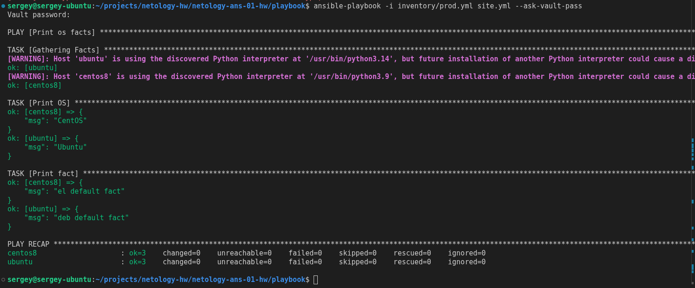

### 8. Список плагинов подключения

Список плагинов подключения получен командой:
```bash
ansible-doc -t connection -l
```
*Флаги: `-t connection` — указание типа плагина, `-l` — вывод списка.*

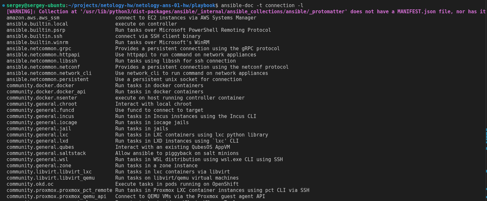

Для работы непосредственно на **control node** (управляющей машине) используется плагин **`ansible.builtin.local`** (описание: `execute on controller`).

### 9. Добавление локальной группы хостов

В `inventory/prod.yml` добавлена группа `local` с хостом `localhost`:

```yaml
  local:
    hosts:
      localhost:
        ansible_connection: local
```

### 10. Финальный запуск playbook

Запуск на обновленном окружении:
```bash
ansible-playbook -i inventory/prod.yml site.yml --ask-vault-pass
```

**Результат:**
Ansible запрашивает пароль (`netology`). Факты для всех хостов определены из верных `group_vars`:
* `centos8` (el) → `el default fact`
* `ubuntu` (deb) → `deb default fact`
* `localhost` (local) → `all default fact`

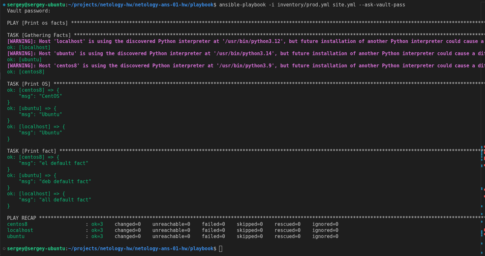

---
## Автор
- **Студент**: Мешков Сергей
- **Курс**: Netology, DevOps
